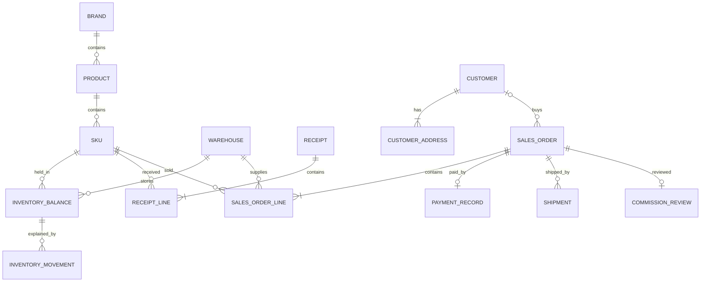

# 数据库设计草案

状态：**待确认，未创建数据库或迁移**。日期：2026-10-03。技术栈已确认 Django＋PostgreSQL；以下表和字段为建议结构。业务规则见 [PRD](PRD.md)，执行规则见 [SPEC](SPEC.md)。

## 1. 设计原则

一个数据库。商品档案表达商品身份，仓库余额表达当前库存，单据及流水解释库存来源，订单保留成交与成本快照。四张报表查询这些数据，不再保存四份手工账。

优先使用 Django 原生用户、分组、权限、会话。固定三类普通角色映射到分组，管理员使用原生超级用户；不自建密码表或权限规则引擎。

业务记录使用内部主键，SKU另有唯一稳定的业务编号；业务编号、条码、物流号均为文本。日期时间建议保存时区信息，展示及报表按 Asia/Shanghai。

已确认报表时间筛选按北京时间，滚动近1、3、6、12个月或自定义日期，首尾当天包含；以实际起止时间查询，不为每个快捷期间存一份报表数据。提成未计入按订单提交日期、已计入按正式计入日期；已计入提成纠错差额按老板批准纠错日期，不改变原计入日期、不与修正后提成重复汇总。

已确认SKU编号规则为IP前缀＋至少4位流水号，按IP人工编号、格式校验及全局唯一；语言规格不编码，使用后不改号、不复用。数据库外键使用独立内部ID。未来新编号规则可用于新SKU，历史编号保持有效；不为此预建编号规则引擎或改号工具。

建议金额使用 `NUMERIC(20,3)`，中间计算使用精度28的 Decimal；这只是容量建议，保存3位和舍入规则已经确认。数量使用非负整数，涉及增减的流水允许有符号整数。字段长度和金额容量必须在实现前核对实际样本，不任意设业务硬上限。

## 2. 基础资料

下表只列关键业务字段；主键及必要创建／更新时间不逐行重复。

| 建议表 | 关键字段与关系 | 约束／说明 |
| --- | --- | --- |
| brand | 名称、SKU前缀 | IP名称不能空；PK-、RB-已确认，其他前缀由用户指定；第一版人工编号 |
| product | brand_id、类型、可空系列、名称、语言、官方编号、别名列表 | 卡牌语言必填且无默认值，周边可空；系列文本；别名建议JSON字符串数组；官方编号非唯一；不按同名强制合并 |
| sku | product_id、内部编号、箱规格、包规格、包类型、售卖单位、条码、规格别名列表、启用状态 | 内部编号必填唯一；条码为可空非唯一文本，重复需人工确认；不保存参考售价 |
| warehouse | 名称、地址、启用状态 | 地址不唯一；同名仓库冲突要求人工核对，不能自动合并 |
| supplier | 名称、启用状态 | 建议最小名称档案，复用选项；单据保留名称快照 |
| channel | 名称、启用状态 | 销售渠道选项，独立于销售人员 |
| payment_account | 名称、方式、对公／私账责任类型、启用状态 | 不保存登录秘密；核对责任类型不能由普通销售改写 |
| customer | 所属销售user_id、姓名、联系方式、公司、别名、生日、兴趣、爱好、归档状态 | 联系方式必填文本，可为电话或微信等；销售创建默认本人，代建明确选择销售；归属变更仅老板／管理员，不改变历史订单销售及提成；无全局姓名或联系方式唯一约束；无逐客户提醒开关 |
| customer_address | customer_id、收件人、联系电话、省份、城市、详细地址 | 地址各字段必填；电话文本、不强制大陆手机号格式；一客户多地址，省市联动选择，仅中国大陆；客户建档与首地址一并提交，无区县选择器 |

SKU增加可空专用预警阈值及提醒关闭标记；一个全局默认阈值由后台修改，具体存储用最小单项设置，不建立通用配置规则平台。专用值为空时取全局默认，关闭时不判断，设置各仓共用；阈值非负整数，库存查询比较各仓可售数量≤有效值。初始默认值为5，并保存一个全局提醒启用开关；全局关闭优先于SKU配置，保留配置以便恢复。不增加单位默认表、仓库覆盖表或提醒任务表。

生日仅保存选填公历日期，客户列表按当天月日计算今天生日标记，不保存冗余提醒状态或新增提醒任务表。已确认每个账号保存一个生日提醒启用布尔值，默认开启，关闭仅影响本人页面，保留客户生日且不影响其他人员；复用账号资料保存，不建立通用偏好平台或逐客户提醒开关。2月29日生日仅当天匹配，非闰年不另日提醒，查看范围沿用客户权限。

低库存全局及SKU提醒默认开启；全局开关与默认阈值由老板／管理员管理，SKU专用阈值及关闭／恢复由仓管、老板／管理员管理，普通销售只查看，兼任仓管时取得SKU设置权限。

产品→SKU是身份与规格的分离，不增加用户操作层级。模板一行一个SKU，产品重复信息由导入预览明确映射到产品。已有业务的资料保留关联，停用不删除历史。

2026-10-03已确认产品导入映射：IP、类型、系列、产品名、语言及官方编号一致作为同产品候选，人工确认预览后导入；共有信息冲突须核对，不模糊归并、不静默覆盖。这是导入识别规则，不以名称或上述组合强制全局唯一；SKU数量和成本仍独立，不增加模板产品编号列。

## 3. 库存与采购

| 建议表 | 关键字段与关系 | 约束／说明 |
| --- | --- | --- |
| inventory_balance | warehouse_id、sku_id、在库、订单占用、客户预留、囤货、破损、库存成本金额、版本 | 仓库＋SKU唯一；非负；受限合计≤在库；可售和平均成本计算得到，不允许直接改余额 |
| inventory_hold | balance_id、类型（客户预留／囤货）、剩余数量、原因、登记人 | 保留锁定原因；余额数量为此表汇总；无客户需求／指定订单配额关系 |
| opening_batch / opening_line | 批次状态、确认人时间；仓库、SKU、期初数量成本及受限数量、备注 | 所有仓库正式期初一次整批确认，成功后关闭入口、拒绝重复覆盖追加；明确来源，期初不是采购，试导隔离 |
| receipt / receipt_line | 供应商、仓库、凭证、确认人时间、版本；SKU、实收数、采购价、分摊运费、入库成本、预留及破损数 | 一单一仓一供应商；确认时采购价必填非负，真实0允许并提示；确认后通过纠错更改，不由通用后台直接改 |
| inventory_movement | 余额关联、来源明细关联、数量与成本金额增减、受限数量增减、执行顺序、操作人时间 | 单据确认与流水余额在同一事务；业务事件顺序明确，无任意删除／改写流水入口 |
| damaged_record / damaged_resolution | 关联采购或期初明细、仓库SKU、未处理破损数；换货／退款、处理数量、库存扣减成本、退款金额、二者差额、未退运费损失、人时间 | 退款按处理时移动平均扣库存，不修改原入库或重算历史订单提成；换货不重复采购；不建完整售后申请系统 |

建议流水使用明确的可空来源外键（期初行、采购行、销售行、拆箱行、赠送行、盘点行、破损处理），数据库约束每条只关联一种来源；同一来源＋事件种类防重复。这样可定位来源，不使用任意表名＋ID代替实际关系。

成本账存金额和数量，平均单位成本由二者计算。已确认订单单位成本先四舍五入保存3位，订单行成本为该快照×数量，减量沿用同一单价；库存中间平均计算保留高精度。实际出库按发货或现场交付时移动平均成本扣减，独立于订单成本快照；扣减结果保存3位，清空时扣完剩余成本，数量金额一同归零，不更改订单成本或提成。破损退款按处理时移动平均成本扣减，同样应用归零规则，不回溯原入库或重算历史订单提成。库存余额是查询加速数据，必须能用有效单据和流水核对。

## 4. 销售、收款、物流及提成

| 建议表 | 关键字段与关系 | 约束／说明 |
| --- | --- | --- |
| sales_order | 销售user_id、可空customer_id、渠道、履约状态、交付方式、收货信息及省市快照、成交／成本／毛利／提成金额、提交／发货／完成时间、版本 | 快照不随客户地址变化；销售地区统计按订单快照；不把核对状态混入履约状态 |
| sales_order_line | order_id、sku_id、warehouse_id、数量、成交单价金额、订单单位成本及成本金额快照、出库库存成本金额 | 同SKU多仓分行；已确认分别保留订单下单成本与实际出库扣减成本 |
| payment_record | order_id、account_id、销售登记金额、截图、可空收款时间、差额原因、核对状态、问题原因、核对人时间、问题暂停标记 | order_id唯一，一单一笔；保存核对所针对订单版本，修改后原通过结果失效 |
| shipment | order_id、承运方、运输编号 | 一单多编号；跨越／顺丰运单号、货拉拉平台订单号 |
| shipment_warehouse | shipment_id、warehouse_id | 关联多个供货仓库，组合唯一；只能关联本订单实际供货仓库 |
| commission_review | order_id、复核结果、对应金额版本、复核人时间、计入时间、可空纠错审批关联 | 一单当前复核记录；三条件满足时记录正式计入时间；已计入提成纠错保留原计入时间；普通修改使有关复核失效；纠错审批不使未审核订单自动计入 |
| commission_adjustment | correction_id、order_id、原值、新值、差额、销售确认完成人时间 | 专门保留采购纠错后的补扣对比，不执行转账；多次纠错分别留记录 |

出库运费建议存各订单行人工分摊金额，默认0，整单汇总；不能同时把总运费和逐行分摊重复扣毛利。已确认下单默认0，发货／现场交付填写已知运费、未知可后补不阻止出货；录入更改重算本单毛利提成，不改商品及剩余库存成本，已复核需重新复核。

截图及送货单仅支持JPEG、PNG、WebP图片，单张最多10MB，可多张；入库凭证选填、收款至少一张。存受控文件目录，数据库存文件引用；访问受单据权限保护，不将内容塞入金额或日志字段，不先创建通用文件管理系统。多图建议采用小型单据图片记录（入库或收款外键二选一、路径、类型、大小、上传人时间），不使用公开文件地址。上传张数技术限制及历史图片保留方案仍需在实施规格落实。

客户散客可空，快递收货信息必须有独立订单快照；创建客户必须有地址，不意味着门店散客必须建档或填快递地址。

省市选项采用一份初始化基础列表，校验城市与省份对应关系；不建立地区管理模块、区县层级或自动更新服务。列表具体存储形式在技术规格中确定，地址及订单须保留可解释的地区值，避免列表更新改变历史订单展示。

## 5. 其他库存单据与必要记录

| 建议表 | 内容 | 说明 |
| --- | --- | --- |
| split_record | source_warehouse_id、target_warehouse_id、来源SKU及数量、目标SKU及数量、承接成本、操作人时间 | 已确认一单同仓或跨仓、单来源单目标，数量手填，来源扣减成本全部转目标，同事务生效；无需多目标明细表或独立调拨表 |
| gift_record / gift_line | 仓库、SKU、数量、原因、操作人 | 减可售实物及库存成本，不产生订单收入或提成 |
| stock_count / stock_count_line | 仓库、盘点时间、账面快照、实盘数、差异、原因、必要单位成本、相关版本、提交及确认人时间 | 确认前不改库存；在库数量变化要求重核该SKU；仅占货解锁不重盘，成本变化刷新金额影响；审批校验当前受限数量 |
| cost_correction | 原采购单或期初批次关联（二选一，包含选定明细）、原因、变更前后快照、影响预览、依赖版本、状态、提交确认人时间 | 原采购纠错记录扩为共同成本来源纠错；期初复用已确认流程，不另建审批表；有影响待老板审批，影响明细建议JSON |
| permission_change | 目标用户／角色、变更前后、修改人时间 | 只覆盖已要求的权限变化记录，不扩展所有操作审计 |

已确认库存调整不足覆盖占用／锁定时，先独立修改有关订单或解锁，再审批调整；复用现有单据和权限，不新建联动调整表。审批重新校验当前数量，历史非负校验仍保留。

纠错影响预览是审批依据，不另造一套有效库存账。有效金额仍保存回对应业务记录；历史变化通过纠错及提成差额记录解释。流水如何保存重算前后的成本版本须随成本方案确定，不能先写一个只覆盖当前余额的实现。

重算顺序已确认按系统实际业务生效顺序，必须保留可确定该顺序的事件记录；人工填写的单据日期不改变执行顺序。此要求不扩大为全量操作审计，具体事件字段及算法仍待验证。

## 6. 关系概览

图只展示核心关系，客户必须有地址等跨行要求由业务事务检查，不声称外键本身已保证这些条件。

## 7. 必要约束与查询索引

- 数据库约束：唯一内部编号、唯一仓库SKU余额、单订单单付款、关联关系与非负数量金额、受限合计不超在库、流水来源合法及执行防重复。
- 服务事务检查：可售检查与占货、截图及差额说明、问题暂停、客户与地址、全仓物流覆盖、账户核对责任、提成三条件、审批依赖版本。
- 建议最初仅给仓库SKU、订单销售／状态／业务日期、客户所属销售、流水余额及顺序、采购仓库及日期建立必要索引。别名包含查询先普通查询，不引入全文检索扩展。
- 历史业务外键禁止级联删除；停用资料仍可查看历史。未提交数据的删除能力不据此默认新增。
- 导出及API在同一查询授权范围执行，不能靠前端隐藏字段或按钮控制。

## 8. 批准前需要确定

本稿尚不是可直接执行的DDL。编号格式、条码规则、卡牌语言、产品导入映射、客户联系方式及地址格式、角色默认权限均已确认；其他IP前缀由用户指定，报表日期口径等仍待确定，成本及并发算法仍须验证，之后才能冻结字段、约束、状态及迁移。
