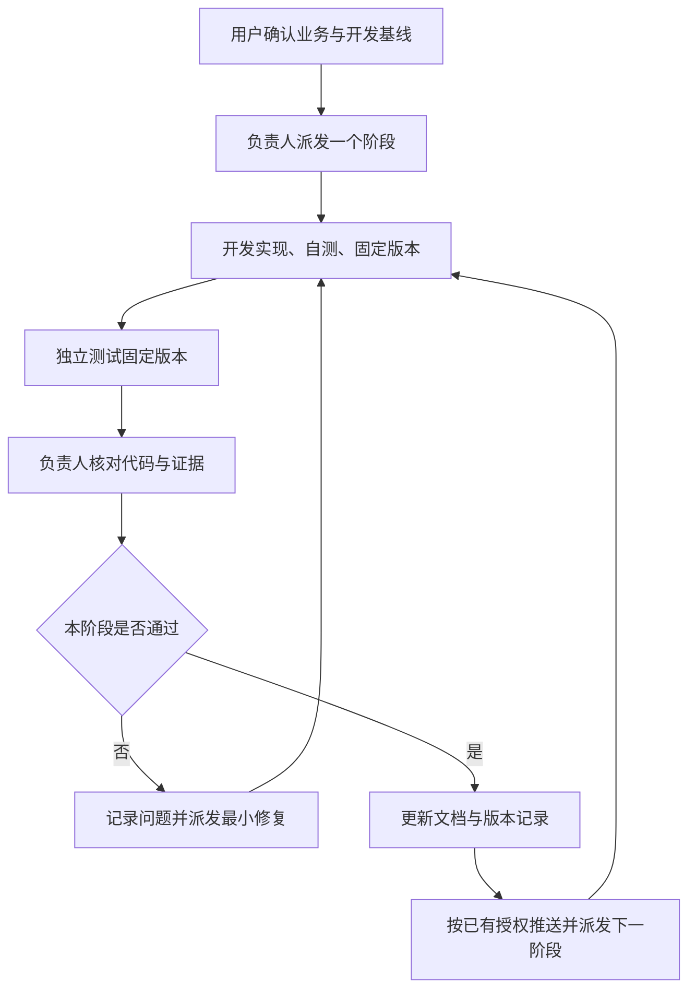

> 历史／方法参考。本文不维护当前任务、会话授权或批准状态；当前依据见[文档入口](../README.md)。旧阶段描述仅在查证时读取。

# 与 AI 协作开发项目的方法

整理日期：2026-10-04。依据本项目多轮需求讨论、基线确认和阶段1—2的实际交付经验整理。

本文总结用户与负责人共同形成的工作方法，便于在本项目交接、后续项目启动时复用。它不新增业务需求，也不替代现有开发基线。项目具体授权、活动会话及消息路径以 [COORDINATION](../project/COORDINATION.md) 为准，实际阶段状态以 [DEVELOPMENT_PLAN](../project/DEVELOPMENT_PLAN.md) 为准。

## 1. 用户与 AI 的分工

用户负责提供实际业务、判断取舍和确认重要规则；AI 负责人负责主持讨论、发现缺口、提出简化方案、整理规格，并把交付推进到可验证的结果。

用户不必一次性写出完整需求。可以从日常操作、困扰、例子和已有表格开始；负责人把这些材料转成明确的问题，让用户逐项决定。负责人不能仅把用户最初的想法翻译成代码，也不能把自己熟悉的商城、CRM 或 ERP 功能默认塞进项目。

用户的业务决策与 AI 的技术判断需要分开：库存如何分配、提成如何计算等由用户确认；在已确认规则下如何使用事务、约束、已有框架等由工程师落实并验证。能由技术证据解决的问题，不反复交给用户拍板。

沟通风格是共同讨论、直接指出问题、以实际例子解释后果。少术语、少空泛承诺；先说结论，再说理由。用户接受建议时及时记录，不重复询问已决定的事项。

## 2. 核心理念：最小、准确、能继续维护

目标是完成真实业务闭环，减少重复录入，让功能可用、数据准确且安全。第一版不追求功能齐全、漂亮架构或预先适配所有未来业务。

奥卡姆剃刀的具体顺序是：不需要就不做 → 复用已有代码 → 标准库 → 平台原生能力 → 已安装依赖 → 最小必要代码。优先简单界面、一个应用、明确规则和少量可解释的数据结构。

“最小”允许把低频分配、沟通、核对等保留在线下，但不能省略输入校验、权限边界、金额精度、防超卖、防重复处理、事务回滚和恢复能力。用人工处理业务判断，不用人工约定替代系统必须保证的数据一致性。

每次新增功能都检查：它解决什么真实问题？不做会阻塞哪一步？能否用现有流程或人工操作解决？是否带来了更多状态、表、权限、自动任务和维护工作？负责人也要拉住用户逐轮增加需求的倾向，说明收益与代价，再确定是否进入第一版。

本项目的典型收敛包括：需求收集与采购分配暂在线下完成；预留解锁后销售正常下单；箱、盒、包各自作为 SKU，不做自动换算；商品分类去掉“是否含卡牌”冗余判断；报表先做四张；省市使用初始化列表，不建地区管理系统。

## 3. 从业务描述到开发基线

### 3.1 先理解现场，再确定边界

从“谁在什么情况下做什么”开始，梳理现有操作、重复登记、准确数据来源和业务痛点。例如，本项目先识别了群消息、银豹、销售 Excel 和财务 Excel 多次登记，以及收款凭证与其他记录不一致的问题。

逐步明确对象、数量、单位、成本、人员身份和时间口径。重点问那些会改变结果的细节：在库与可售是否相同、何时占货、成本何时固定、谁能放行、取消是否释放、已发生事实能否修改。

对于含糊词，负责人给出两种可能解释和数字例子，请用户选择。不能因为“看起来像商城”就默认套用商城行为。

### 3.2 按模块主持讨论，一次敲定一个关键问题

推荐每轮采用以下节奏：

1. 简短复述当前已理解的流程。
2. 指出一个会影响实现或结果的缺口。
3. 给出最小建议及具体例子，必要时比较少量备选方案。
4. 用户确认后记录决定，再进入下一个问题。

用户语塞时，给业务场景启发，而不是要求用户自行写专业规格。模块讨论结束时，把每个人的操作、进入下一步的条件和异常处理总结一遍，供用户核对。

影响库存、成本、收款或提成的未知规则，必须先确认。暂停依赖该规则的工作，继续独立部分。一般实现选择可以在既有边界内作技术判断；发现明确矛盾时说明采用哪条最新规则，不默默混合。

### 3.3 形成文档，再批准编码

先整理业务共识和模块规则，再形成 PRD、数据库设计、SPEC、API 合同及关键验收场景。核对同一个规则在不同文档中的公式、状态、权限、字段和示例是否一致。

PRD回答做什么及使用流程；数据库设计回答事实如何保存和关联；SPEC回答如何计算、校验与执行；验收场景回答怎样证明正确。不能用数据库字段倒推未确认的业务，也不能把“建议”“待确认”写成既定规则。

用户批准完整开发基线后再编码。后续明确变更更新相关文档和验收，不必重新讨论所有已定规则；记录哪些旧规则已被替代，避免新会话沿用旧聊天结论。

真实期初数据与开发基线是两个门槛：用户可另行盘点和补齐样例，开发测试先用合成数据。样例验证通过不代表正式库存已入账。

## 4. 分阶段交付的循环

按可验证的业务范围切阶段，每次只派发一个阶段。阶段任务明确目标、依据、允许修改范围、暂不做的事项、必要测试和交接对象。

开发自测、独立测试与负责人审查各有作用。自动化测试通过不代表业务完整，更不代表可以直接上线；负责人需要核对测试是否覆盖了重要风险，并审查事务、计算、权限及异常路径。

发现问题时修根因、补最小回归，不借返工扩大范围。修复后只重复受影响的验证及必要回归；没有新变化或风险时，不反复执行无关测试。

本项目 D11 提供了具体例子：已有库存时禁止修改单位的顺序测试通过，但负责人发现“表单先校验、首次入库后再保存”的并发漏洞。修复采用现有业务控制锁，独立测试再以真实 PostgreSQL 两种操作顺序验证；没有新增审批、换算工具或并发框架。

## 5. 多会话协作方式

### 5.1 三个角色，一位负责人

| 角色 | 职责 | 交付边界 |
| --- | --- | --- |
| 用户 | 提供业务事实、确认重要规则与范围、授权推进 | 不承担编写技术规格或排查技术竞态的工作 |
| 负责人 | 主持讨论、维护基线、派发阶段、审查代码和测试、记录结论及推进 | 对阶段是否通过作最终判断，不以口头“已完成”作为证据 |
| 开发工程师 | 实现明确范围、自测、固定版本、交给测试 | 交接后停止应用写入，不自行推进下一阶段 |
| 测试工程师 | 独立验证固定版本、复现问题、报告证据与限制 | 不直接修业务代码，不自行宣布项目整体完成 |

当前用户指定负责人为 GPT-6.1 Sol Medium，开发和测试为 GPT-6 Luna Extra High。模型选择服务于职责，不能替代清晰任务与验收。实际会话 ID 统一存放在 COORDINATION，本文不再复制一份名单。

授权消息路径是：负责人 → 开发 → 测试 → 负责人；失败由负责人决定返工，再发给开发。通过现有会话工具交接，不另建消息队列、Bot或轮询系统。

### 5.2 同一目录只保留一个应用写入者

开发期间负责人主要阅读、审查；独立测试期间开发停止修改应用。测试补充测试文件需要明确授权。文档写入也要避开对方正在维护的文件，避免相互覆盖。

每次交接使用明确提交版本。测试前确认被测版本，测试期间若版本改变，重新确定范围，不能把不同版本的结果合成一个“通过”。

开发任务、测试报告和负责人决定都应自包含，使接收者不用翻大量聊天才能执行。以下简短模板可复用：

**阶段派发**：基线与阶段目标；本次范围和排除项；关键规则及验收；允许写入的文件/职责；测试环境与数据边界；固定版本及报告对象。

**开发交付**：应用提交和文档提交；实际实现；运行与自测命令及结果；已知限制/问题；交给谁测试；已停止应用写入。

**独立测试报告**：被测提交；环境和数据；实际执行及结果；失败复现或通过证据；未测项；清理情况；是否建议本阶段通过。

**负责人决定**：审查对象；核对内容；通过或返工及原因；问题状态；下一动作及授权依据。

### 5.3 逐个更换上下文

不按固定 token 数机械切会话；发现无法清楚复述当前任务、上下文质量下降或出现反复遗漏时，先整理交接状态。

交接至少保存：当前基线和交付版本、阶段状态、角色会话、未决问题、用户授权边界、工作区已有修改、环境及精确下一动作。接任者先读文档并复述待办，确认接任后更新登记、告知其他角色，原角色停止派发或写入。

一次只更换一个角色，不能同时更换负责人、开发和测试。已有稳定会话继续承担工作，避免所有角色同时失去上下文。

## 6. 文档、测试和排障纪律

文档是跨会话的工作依据，聊天是讨论和通知渠道。重要决定、交付版本及问题必须及时落文档，不能等到上下文压缩后再凭印象补写。

| 内容 | 唯一主要记录位置 |
| --- | --- |
| 已确认业务规则 | PROJECT_CONSENSUS及对应模块文档 |
| 功能、设计及验收 | PRD、SPEC、DATABASE_DESIGN、API_CONTRACT、ACCEPTANCE |
| 当前阶段、交付与验收证据 | DEVELOPMENT_PLAN |
| 阻断、待确认及已解决问题 | ISSUE_LOG，重复问题更新原 ID |
| 会话、消息路径及持续授权 | COORDINATION |
| 工程行为要求 | 根目录 AGENTS.md |

除 AGENTS.md 外项目文档放在 docs。方法文档不再维护业务公式副本、当前进度表或第二套问题账。

测试围绕业务意图：正常路径、关键边界、失败回滚、权限、幂等和并发。库存锁使用真实 PostgreSQL 验证，不能以 SQLite 或仅顺序测试证明并发正确。用户操作入口需要实际网页或 HTTP 路径验证，不能只测内部函数。

业务单据与流水用于解释数据来源；诊断日志用于定位故障，两者不能互相替代。日志分级、以请求或单据 ID 关联、避免重复和个人信息，限制轮转容量。新增或调整日志点先说明位置、目的、级别、字段和频率并确认；既有批准方案无需再询问。不默认采集全部操作，也不搭建复杂监控平台。

代码发现优先项目知识图谱，文档和配置可以直接搜索。修改前读目标、调用方和共享工具，沿用当前结构，保持改动集中。

真实客户、库存成本、凭证和秘密不入 Git。只提交本次已知文件，保留用户已有修改。测试结束清理自己创建的数据库和临时文件，不停止原先运行的服务。

## 7. 授权与自主推进

需要用户决定的是业务结果、明显扩大范围、超出已批准日志方案或尚未授权的外部行动。已授权范围内的常规实现、验证和最小修复由负责人及工程师继续执行，不因用户暂时离开而反复索要确认。

本项目用户已于2026-10-04授权：开发完成、独立测试通过且负责人复核通过后，更新相关文档、推送 GitHub并启动下一阶段，无需逐轮询问。该授权不意味着可以跳过验收、提交真实数据或部署生产。

不确定点先记录并暂停依赖工作，持续推进独立部分。工具或服务不可用时报告具体阻断，恢复后从最后验收通过的阶段继续。会话协作并不保证服务中断或额度不足时仍能运行。

## 8. 本次整理提出的流程优化

以下是方法层面的建议，供后续采用；不自动修改现有 AGENTS、开发基线或授权。它们尽量复用当前文档，不增加管理平台、审批或新的进度文件。

| 优化 | 怎样做 | 解决什么问题 |
| --- | --- | --- |
| 先确定最小完整业务路径，再展开低频边界 | 模块开始先用一个正常例子串起人员、输入、结果和下一步；异常只讨论会影响当前闭环或数据正确性的情形 | 防止问题清单越讨论越长、主流程反而模糊 |
| 区分三类问题 | ISSUE_LOG中明确业务待确认、技术待验证、上线前待办；每项写出阻断哪一步及关闭证据 | 避免把技术选择都交给用户，或把上线前事项误当开发阻断 |
| 让最新结论更容易找到 | 每份进度/协作文档开头给当前状态；历史记录保留但标为历史，新决定写明替代关系，避免反复追加相似段落 | 防止旧“待复测”“未开始”段落干扰新会话判断 |
| 用短交接模板替代超长重复指令 | 引用固定基线，只列本阶段范围、特殊风险、版本、验收及下一动作；关键规则确需重复时保留 | 降低上下文消耗，同时减少遗漏 |
| 明确证据覆盖范围 | 验收写清哪些是开发自测、独立测试、负责人审查，涉及哪版、哪条路径；“通过”限定到本阶段 | 避免把测试数量等同于质量、把局部通过当整体完成 |
| 为新增需求记录代价 | 在原需求或问题条目简记新增状态/字段/操作与受影响阶段，再决定现在做、人工处理或延期 | 帮用户看见复杂度，持续落实奥卡姆剃刀 |

其中“当前状态置顶”在现有文档里已有部分实践，但历史段落仍容易产生过时表述；建议后续在相应文件的正常维护时校准，不趁工程师开发时大范围改写共享文档。

## 9. 新项目可直接使用的开场约定

> 请先理解真实业务、指出漏洞并主持逐项确认，不把我的初步方案当成唯一答案。按照奥卡姆剃刀实现最小完整功能，数据正确性、权限、并发和恢复能力不能省。重要业务规则不猜测，已确认范围内的实现自主推进。先形成并校准共识、PRD、数据库设计、SPEC和验收，经我批准后分阶段开发。由一位负责人统筹开发与独立测试会话，每阶段固定版本、测试、复核、落文档后再推进。用文档保存决定、进展、问题与交接，防止上下文丢失；新增需求说明复杂度，新增日志点先确认。具体模型、消息路径、推送和部署授权在项目开始时分别约定。

复用时替换项目业务与授权条件，不能直接沿用本项目的 Git 推送、模型或会话管理授权。
