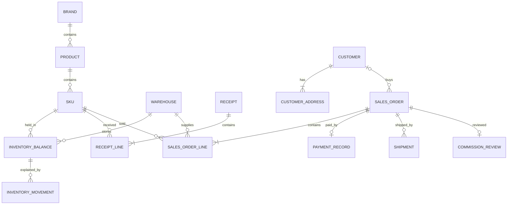

# 数据库设计

> **2026-10-20成本口径：** 本文已按实际出库成本及独立提成差额确认规则校准。本轮应用 `6024205` 已完成分项QA/UI、现场/快递网页链及负责人限定验收，证据见[发布记录](../project/RELEASE_COST_WORKFLOW_20261020.md)；已部署版仍为 `71cf9f6`/0015。新单实际出库计成本，既存旧单保留快照，不将代码验收当正式业务切换。

> 2026-10-09增量开发合同已收口，见本文新增章节及[本轮需求](../project/USER_REVISION_20261009.md)。获批UI见revision-v1/HANDOFF；下列增量是开发目标，尚未实现或发布。既有金额、库存及权限规则继续有效，旧阶段验收状态以开发计划为准。

状态：**已批准的第一版开发基线**。批准日期：2026-10-03。技术栈为 Django＋PostgreSQL；以下表和字段按阶段实施，批准不代表数据库或迁移已创建。业务规则见 [PRD](PRD.md)，执行规则见 [SPEC](SPEC.md)。

## 1. 设计原则

一个数据库。商品档案表达商品身份，仓库余额表达当前库存，单据及流水解释库存来源，订单保留成交快照及明确的销售成本口径。四张报表查询这些数据，不再保存四份手工账。

优先使用 Django 原生用户、分组、权限、会话。固定三类普通角色映射到分组，管理员使用原生超级用户；不自建密码表或权限规则引擎。

业务记录使用内部主键，SKU另有唯一稳定的业务编号；业务编号、条码、物流号均为文本。日期时间建议保存时区信息，展示及报表按 Asia/Shanghai。

已确认报表时间筛选按北京时间，滚动近1、3、6、12个月或自定义日期，首尾当天包含；以实际起止时间查询，不为每个快捷期间存一份报表数据。提成未计入按订单提交日期、已计入按正式计入日期；已计入提成纠错差额按老板独立确认提成调整日期，不改变原计入日期、不与修正后提成重复汇总。

已确认SKU编号规则为IP前缀＋至少4位流水号，按IP人工编号、格式校验及全局唯一；语言规格不编码，使用后不改号、不复用。数据库外键使用独立内部ID。未来新编号规则可用于新SKU，历史编号保持有效；不为此预建编号规则引擎或改号工具。

技术总审建议金额使用 `NUMERIC(20,3)`，中间计算使用精度50的Decimal；保存3位和舍入规则已经确认。数量使用非负BIGINT，涉及增减的流水允许有符号BIGINT；溢出明确拒绝，不截断或转浮点。字段长度与容量是技术建议，见第9节，不任意增加业务异常大值审批。

## 2. 基础资料

下表只列关键业务字段；主键及必要创建／更新时间不逐行重复。

2026-10-28订单编号增量（迁移0019）：`SalesOrder.order_number`是可空、唯一、不可编辑的最长27字符文本；旧行保持空值，不补号或删除。新单在现有`BusinessControl`行锁事务内，使用持久化`created_at`的北京时间日期及当天流水生成编号；控制行增加可空`last_sales_order_date`及默认0的`last_sales_order_daily_sequence`。四位仅补零，不限制每日9999单；取消不回收，幂等重放沿用原编号。主键、外键、`last_sequence`及版本字段不改；旧空号仅展示稳定内部ID，不展示操作序号。0019仅隔离验收，运行库尚未升级。

| 建议表 | 关键字段与关系 | 约束／说明 |
| --- | --- | --- |
| brand | 名称、SKU前缀 | IP名称不能空；PK-、RB-已确认，其他前缀由用户指定；第一版人工编号 |
| product | brand_id、类型、可空系列、名称、语言、官方编号、别名列表 | 类型为“补充包”“周边”“礼盒·预组”三个选项；补充包及礼盒·预组的语言必填且无默认值，周边可空；系列文本；别名建议JSON字符串数组；官方编号非唯一；不按同名强制合并 |
| sku | product_id、内部编号、包类型、售卖单位、条码、规格别名列表、启用状态 | 内部编号必填唯一；条码为可空非唯一文本，重复需人工确认；不保存参考售价 |
| warehouse | 名称、地址、启用状态 | 地址不唯一；同名仓库冲突要求人工核对，不能自动合并 |
| supplier | 名称、启用状态 | 建议最小名称档案，复用选项；单据保留名称快照 |
| channel | 名称、启用状态 | 销售渠道选项，独立于销售人员 |
| payment_account | 名称、方式、对公／私账责任类型、启用状态 | 不保存登录秘密；核对责任类型不能由普通销售改写 |
| customer | 所属销售user_id、姓名、联系方式、公司、别名、备注1/2、发票抬头、信用代码、电子邮箱、归档状态 | 姓名必填、联系方式选填文本（2026-10-22更新），可为电话或微信等；销售创建默认本人，代建明确选择销售；归属变更仅老板／管理员，不改变历史订单销售及提成；无全局姓名或联系方式唯一约束；不开票及选填缺失不标不完整 |
| customer_address | customer_id、收件人、联系电话、省份、城市、详细地址 | 地址各字段必填；电话文本、不强制大陆手机号格式；一客户多地址，省市联动选择，仅中国大陆；客户建档可无地址（2026-10-22更新），主动保存地址时每条完整，无区县选择器 |
| account_profile | user_id、version | 仅保留历史业务操作外键目标；删除生日偏好字段，不提供新的偏好功能 |

SKU增加可空专用预警阈值及提醒关闭标记；一个全局默认阈值由后台修改，具体存储用最小单项设置，不建立通用配置规则平台。专用值为空时取全局默认，关闭时不判断，设置各仓共用；阈值非负整数，库存查询比较各仓可售数量≤有效值。初始默认值为5，并保存一个全局提醒启用开关；全局关闭优先于SKU配置，保留配置以便恢复。不增加单位默认表、仓库覆盖表或提醒任务表。

2026-10-09替代：删除客户生日数据及全部生日提醒，旧兴趣／爱好分别迁为备注1／备注2；客户一套选填开票资料，订单记录开票需求及当次快照，不执行开票。迁移保留历史业务目标关联，具体增量约束见文末。

低库存全局及SKU提醒默认开启；全局开关与默认阈值由老板／管理员管理，SKU专用阈值及关闭／恢复由仓管、老板／管理员管理，普通销售只查看，兼任仓管时取得SKU设置权限。

产品→SKU是身份与规格的分离，不增加用户操作层级。模板一行一个SKU，产品重复信息由导入预览明确映射到产品。已有业务的资料保留关联，停用不删除历史。

2026-10-03用户最新决定Q04：不保存“是否含卡牌”布尔值，由人工负责商品分类；纯周边选择周边，含卡牌的礼盒／套装／预组选择礼盒·预组。补充包及礼盒·预组语言必填，周边可空，直接依据类型校验，不增加额外判断选项或导入确认字段；替代原基线中的contains_cards设计。

2026-10-03已确认产品导入映射：IP、类型、系列、产品名、语言及官方编号一致作为同产品候选，人工确认预览后导入；共有信息冲突须核对，不模糊归并、不静默覆盖。这是导入识别规则，不以名称或上述组合强制全局唯一；SKU数量和成本仍独立，不增加模板产品编号列。

## 3. 库存与采购

| 建议表 | 关键字段与关系 | 约束／说明 |
| --- | --- | --- |
| inventory_balance | warehouse_id、sku_id、在库、订单占用、客户预留、囤货、破损、库存成本金额、版本 | 仓库＋SKU唯一；非负；受限合计≤在库；可售和平均成本计算得到，不允许直接改余额 |
| inventory_hold | balance_id、类型（客户预留／囤货）、剩余数量、原因、登记人 | 保留锁定原因；余额数量为此表汇总；无客户需求／指定订单配额关系 |
| opening_batch / opening_line | 批次状态、确认人时间；仓库、SKU、期初数量成本及受限数量、备注 | 所有仓库正式期初一次整批确认，成功后关闭入口、拒绝重复覆盖追加；明确来源，期初不是采购，试导隔离 |
| receipt / receipt_line | 供应商、仓库、凭证、确认人时间、版本；SKU、实收数、采购价、分摊运费、入库成本、预留及破损数 | 一单一仓一供应商；确认时采购价必填非负，真实0允许并提示；确认后通过纠错更改，不由通用后台直接改 |
| inventory_movement | 余额关联、来源明细关联、数量与成本金额增减、受限数量增减、执行顺序、操作人时间 | 单据确认与流水余额在同一事务；业务事件顺序明确，无任意删除／改写流水入口 |
| damaged_record / damaged_resolution | 关联采购或期初明细、仓库SKU、未处理破损数；换货／退款、处理数量、库存扣减成本、退款金额、二者差额、未退运费损失、人时间 | 退款按处理时移动平均扣库存，不修改原入库或重算历史订单提成；换货不重复采购；不建完整售后申请系统 |

建议流水使用明确的可空来源外键（期初行、采购行、销售行、拆箱单、赠送行、盘点行、破损处理），数据库约束每条只关联一种来源。防重复按一次业务操作标识＋来源明细（或拆箱单）＋余额＋事件种类约束，不能仅按来源明细＋事件种类唯一：同一订单可以多次合法改量，同一破损记录也可分次处理。跨仓拆箱的两端共用操作标识，但各有对应余额流水。这样可定位来源，不使用任意表名＋ID代替实际关系。

历史重算还必须保留订单提交及修改时的必要业务输入：当时各明细的仓库SKU、数量、成交价，以及该次成本口径及旧快照单的固定／沿用／重新固定方式。仅有当前订单行和占货差量不足以重建历史。建议复用流水所属的业务操作记录保存最小输入快照和确定顺序，单据可多次操作，每次操作可有多条流水；不记录普通浏览、地址或备注编辑，不建立全量审计或事件溯源框架。具体结构与重算版本方案仍待总审。

成本账存金额和数量，均价由二者计算。新单cost_basis=actual_outflow，未出库正式成本、毛利、提成及行成本可空；出库事务以库存流水实际扣减总额确定订单成本，同仓SKU按数量分摊明细、末行承接尾差。旧order_snapshot记录保留原3位单位快照及行成本，不批量改算。库存中间精度50、保存3位，清空扣尽剩余成本；破损退款仍按处理时均价扣减，不回溯旧销售。余额必须与有效单据流水一致。

## 4. 销售、收款、物流及提成

| 建议表 | 关键字段与关系 | 约束／说明 |
| --- | --- | --- |
| sales_order | 销售user_id、可空customer_id、渠道、履约状态、交付方式、收货信息及省市快照、成交／成本／毛利／提成金额、提交／发货／完成时间、版本 | 快照不随客户地址变化；销售地区统计按订单快照；不把核对状态混入履约状态 |
| sales_order_line | order_id、sku_id、warehouse_id、数量、成交单价金额、可空unit_cost_snapshot及order_cost_amount、cost_mode | 新单未出库为空；出库后order_cost_amount为实际成本分摊，单位快照仍空；库存扣减证据在InventoryMovement，不另加出库成本字段 |
| payment_account | 名称、支付方式、责任=对公／老板私账、启用状态 | 通过Django Admin维护；不保存账户登录秘密 |
| payment_record | order_id、account_id、销售登记金额、收款图片关联、系统首次凭证登记时间、可空实际收款时间、差额原因、核对状态、问题原因、核对人时间、问题暂停标记、期望及已核版本 | order_id唯一，一单一笔；核对绑定订单应收金额及收款信息版本，不绑定地址备注等无关版本；有关内容修改后原通过结果失效 |
| shipment | order_id、承运方、运输编号 | 一单多编号；跨越／顺丰运单号、货拉拉平台订单号 |
| shipment_warehouse | shipment_id、warehouse_id | 关联多个供货仓库，组合唯一；只能关联本订单实际供货仓库 |
| commission_review | order_id、对应金额版本、最后批准金额、复核人时间、原计入时间 | 一单当前复核记录；三条件满足时首次计入；已计入普通修改待重审仍保留原日期与旧批准金额，再次通过更新批准金额，不把新计算值当已批准 |
| commission_adjustment | approval_operation_id、order_id、原因类型(initial/rereview/cost_correction)、原值、新值、差额、确认人时间、销售确认完成人时间 | 当前阶段记录首次核定及重审差额；差额为新值减上次批准值；多次批准分别记录，不转账，不重复加到已批准提成汇总；成本纠错仅独立确认非零调整才写本表，待决定建议在纠错JSON，keep决定在BusinessOperation |

阶段4当前实现：`sales_order.status`约束允许`awaiting_payment`、`ready_to_ship`、`shipped`、`completed`、`cancelled`；付款核对状态独立于履约状态，订单保留`payment_version`、`amount_version`、`shipped_at`及`completed_at`。销售订单行有稳定主键和`active`标记，修改移除行不物理删除；每次业务操作保留当时SKU、仓库、数量、成交价、单位成本、行成本及固定／沿用／重算模式。占货流水以销售订单为来源；履约出库按库存移动平均成本记流水并释放占货。

出库运费建议存各订单行人工分摊金额，默认0，整单汇总；不能同时把总运费和逐行分摊重复扣毛利。已确认下单默认0，发货／现场交付填写已知运费、未知可后补不阻止出货；录入更改重算本单毛利提成，不改商品及剩余库存成本，已复核需重新复核。

图片仅支持JPEG、PNG、WebP，单张最多10MB，上传时校验实际内容及解码；收款登记至少一张，单据最多20张。现有`ReceiptImage`复用图片存储，入库凭证或收款外键最多一个；文件无公开地址，访问受单据权限控制，未关联暂存图片仅上传者可读，过期暂存图片24小时后清理，已关联凭证保留。

客户散客可空，快递收货信息必须有独立订单快照；创建客户必须有地址，不意味着门店散客必须建档或填快递地址。

省市选项固定随代码存于`crm/data/provinces_cities.json`，不建数据库地区表、地区管理模块、区县层级或自动更新服务。文件是`cn-division 2026.0.1`上游提交`88f2021ea21769bdb95d93699d8a625fcd9165ef`的`pc.json`整理快照：31个省级项、371个下级选项。上游数据由民政部全国地名信息库接口生成；民政部行政区划代码按年度发布规则于次年1月公布前一年度数据。上游文件SHA256为`03f340e2f346588fadb3af8094946fa1ef5fc18ee8f0fae9b03fabe47b826062`，项目整理文件SHA256为`f654aa339fd949dd13ae86def07cd97732b85f0f9151b00812eef31efd99b181`。来源：[民政部地名信息库](https://dmfw.mca.gov.cn/)、[民政部行政区划代码发布规则](https://www.moj.gov.cn/pub/sfbgw/flfggz/flfggzbmgz/202512/t20251204_528920.html)、[固定版本上游文件](https://raw.githubusercontent.com/kk-418/cn-division/88f2021ea21769bdb95d93699d8a625fcd9165ef/dist/code/pc.json)。选择器用代码定位选项并校验父子关系；客户地址和订单只保存省、市文字快照，历史显示不跟随名单变更。

## 5. 其他库存单据与必要记录

| 建议表 | 内容 | 说明 |
| --- | --- | --- |
| split_record | source_warehouse_id、target_warehouse_id、来源SKU及数量、目标SKU及数量、承接成本、操作人时间 | 已确认一单同仓或跨仓、单来源单目标，数量手填，来源扣减成本全部转目标，同事务生效；无需多目标明细表或独立调拨表 |
| gift_record / gift_line | 仓库、SKU、数量、原因、操作人 | 减可售实物及库存成本，不产生订单收入或提成 |
| stock_count / stock_count_line | 仓库、盘点时间、账面快照、实盘数、差异、原因、必要单位成本、相关版本、提交及确认人时间 | 提交人指当前有效提交/重核人；原创建及每次重核人保留业务操作；确认前不改库存；在库数量变化要求重核该SKU；仅占货解锁不重盘，成本变化刷新金额影响；审批校验当前受限数量 |
| cost_correction | 原采购单或期初批次关联（二选一，包含选定明细）、原因、变更前后快照、影响预览、依赖版本、状态、提交确认人时间 | 原采购纠错记录扩为共同成本来源纠错；期初复用已确认流程，不另建审批表；有影响待老板审批，影响明细建议JSON |
| permission_change | 目标用户／角色、变更前后、修改人时间 | 只覆盖已要求的权限变化记录，不扩展所有操作审计 |

已确认库存调整不足覆盖占用／锁定时，先独立修改有关订单或解锁，再审批调整；复用现有单据和权限，不新建联动调整表。审批重新校验当前数量，历史非负校验仍保留。

盘点记录保留实盘数量及采用移动平均或人工输入成本的依据；纠错回放据当时重建余额重新计算盘点差量，不覆盖实盘观测事实，变化进入老板确认预览。

纠错影响预览是审批依据，不另造一套有效库存账。有效金额仍保存回对应业务记录；历史变化通过纠错及提成差额记录解释。流水如何保存重算前后的成本版本须随成本方案确定，不能先写一个只覆盖当前余额的实现。

重算顺序已确认按系统实际业务生效顺序，必须保留可确定该顺序的事件记录；人工填写的单据日期不改变执行顺序。此要求不扩大为全量操作审计，具体事件字段及算法仍待验证。

## 6. 关系概览

图只展示核心关系，客户必须有地址等跨行要求由业务事务检查，不声称外键本身已保证这些条件。

## 7. 必要约束与查询索引

- 数据库约束：唯一内部编号、唯一仓库SKU余额、单订单单付款、合法关联关系、余额数量与成本非负、受限合计不超在库、流水来源合法及执行防重复。采购及销售明细数量必须为正；流水数量／成本增减、盘点差异、毛利、提成和纠错差额允许负数，不能使用统一的“所有金额非负”约束。采购单价、运费、成交单价及登记收款金额按非负金额校验；清空库存时成本必须为0。
- 服务事务检查：可售检查与占货、截图及差额说明、问题暂停、客户与地址、全仓物流覆盖、账户核对责任、提成三条件、审批依赖版本。
- 建议最初仅给仓库SKU、订单销售／状态／业务日期、客户所属销售、流水余额及顺序、采购仓库及日期建立必要索引。别名包含查询先普通查询，不引入全文检索扩展。
- 历史业务外键禁止级联删除；停用资料仍可查看历史。未提交数据的删除能力不据此默认新增。
- 导出及API在同一查询授权范围执行，不能靠前端隐藏字段或按钮控制。

## 8. 总审状态

本稿是已批准的第一版数据模型基线。2026-10-05阶段5应用`e527524`及迁移0010—0012实现拆箱、赠送、破损处理、盘点及成本纠错模型；PostgreSQL全量101项、系统检查、迁移漂移检查及编译通过，独立测试和负责人复核待进行。阶段6报表仍未开始。进度及验证记录在[开发计划](../project/DEVELOPMENT_PLAN.md)，未确认及未解决问题见[问题记录](../project/ISSUE_LOG.md)。

## 9. 字段、约束与历史记录补全（技术总审稿）

通用：内部主键BigAutoField；时间为带时区datetime；有效历史外键PROTECT，普通资料停用不删除；业务单据版本正整数从1开始。姓名／名称、内部编号、条码、物流号建议CharField(255)，规格、地址、原因、联系方式使用TextField；列表别名用JSON字符串数组，去空白去本行重复，但不跨商品合并。数量字段BIGINT，金额NUMERIC(20,3)。这些是技术容量，不要求用户逐个参数确认。

表名仅表达模型，采用Django实际表名前缀。下列字段补充前面逻辑表，不另建同名副本。

| 模型／新增字段 | 类型及默认 | 必要约束 |
| --- | --- | --- |
| 原生User／Group／Permission及account_profile | profile.user一对一；保留历史引用，移除生日偏好字段 | 复用原生密码会话；仅管理员改superuser；员工停用后禁止新会话及业务动作 |
| business_control | 固定主键1，last_sequence=0，low_stock_enabled=true，default_threshold=5，opening_completed=false、opening_enabled=true | 单例，由业务服务锁定，不开放普通后台编辑序号；低库存设置独立授权 |
| product.type | booster／merchandise／gift_set，显示补充包／周边／礼盒·预组；不存contains_cards | booster及gift_set的language非空且无默认值；merchandise可空；由人工选择商品类型，不猜名称；无多级分类 |
| sku预警 | threshold可空、reminder_enabled=true | threshold≥0；入库留空更新为继承默认，开关单独明确提交；已有SKU单位及产品身份有业务后不允许静默改写历史 |
| inventory_balance | on_hand、occupied、reserved、hoarded、damaged默认0，cost_amount=0，version=1，quantity_version=1 | 仓库SKU唯一，均非负，四类受限之和≤on_hand，on_hand=0要求cost_amount=0；只改变成本不增quantity_version，在库变化增该版本 |
| business_operation | sequence可空且唯一；operation_key UUID唯一；actor_id、action、input_hash、payload JSON、created_at；具体target外键一项 | 库存／客户／订单写操作目标恰一非空，包含customer、sales_order、account_profile；业务事件序号在BusinessControl锁内分配，旧个人提醒偏好历史sequence可空，仅保留关联，不继续提供该动作 |
| inventory_movement补全 | operation_id、balance_id、event_kind、entry_key、on_hand_delta及四类受限delta、cost_delta、cost_revision=1；具体来源外键 | operation＋balance＋event_kind＋entry_key唯一；entry_key为该次输入中稳定行ID／拆箱端，实际来源外键恰一；来源FK含锁定记录，不能用任意表名字符串代替 |
| inventory_hold补全 | initial_quantity、remaining_quantity、type、reason、creator_id、version | 0≤remaining≤initial；释放按具体记录，余额对应数量等于所有未释放记录合计；预留可写普通原因，囤货必须原因 |
| opening_line补全 | unit_cost、cost_amount、reserved、hoarded、damaged、hoard_reason | 新建期初服务校验受限数量不超过实盘数量，cost_amount=round3(quantity×unit_cost)；通过确认创建对应hold和damaged记录，不只写余额。纠正历史来源时保留之后释放／处理事件，约束最终重放状态合法，不以当前来源字段重建过去时点限制 |
| receipt_line补全 | 稳定行ID；quantity、purchase_price、inbound_freight、cost_amount、reserved、damaged | 新建采购服务校验quantity>0、金额非负及reserved＋damaged≤quantity；确认生成受限明细；同SKU多行累计检查，不重复设置冲突阈值。历史纠错不设来源行限制合计的数据库CHECK，以容纳后续释放／处理事件；仍校验历史实物不为负和最终余额限制合法 |
| damaged_record补全 | balance_id、receipt_line/opening_line二选一、original_quantity、remaining_quantity、version | 来源明确，remaining不超过原数量；余额破损数为当前剩余明细合计；原来源更正不得使已处理数量无依据 |
| damaged_resolution补全 | record_id、kind、quantity、refund_amount可空、deducted_cost、difference、unreturned_freight、operator_id、confirmed_at | exchange退款字段为空；refund实退必填、quantity≤未处理量；difference=扣减成本－退款；不重复相加运费损失 |
| sales_order补全 | delivery_mode=shipment/on_site；status为awaiting_payment/ready_to_ship/shipped/completed/cancelled；customer_name及收件省市地址快照；payment_version、amount_version、version；shipped_at、completed_at | 快递必填完整收件，现场散客可空；订单版本用于并发修改及履约；付款状态独立 |
| sales_order_line补全 | 稳定行ID、active、quantity、unit_price、revenue_amount、unit_cost_snapshot、order_cost_amount、outbound_freight=0、cost_mode | quantity>0；修改不物理删除行；新单未出库成本为空、修改只处理占货及收入；出库后按实际成本分摊；旧快照单仍按原修改规则 |
| payment_record补全 | expected_payment_version、verified_version可空、status=pending/problem/passed、paused=false | 订单一对一；图片至少一张才能进入待出库；problem原因非空；更新凭证不清除已有暂停，核对通过才能解除 |
| commission_review补全 | order一对一、approved_amount可空、approved_amount_version可空、first_earned_at可空、reviewer_id及reviewed_at | 未批准金额为空不默认0；首次三条件齐备才写first_earned_at；已计入重审旧批准金额保留，不能只按当前条件抹掉旧月份金额 |
| commission_adjustment补全 | approval_operation_id、order_id、kind=initial/rereview、old_amount、new_amount、delta、confirmed_at、completed_by/time可空 | 批准操作＋订单唯一；delta=new-old；阶段5再扩展成本纠错关联；销售完成仅影响线下处理标记 |
| receipt_image | receipt_id/payment_id至多一项，未关联暂存时两者均空；owner_id、file、image_format、size、created_at | 绑定后按单据授权，文件无公开地址；每单最多20张、暂存24小时清理；旧已关联凭证保留 |
| stock_count_line补全 | balance_id、observed_quantity、captured_quantity_version、basis_cost_version、delta、cost_mode=average/manual、manual_unit_cost可空、supplemental_unit_cost可空、supplement_approval_id可空 | 观测数≥0，manual必填；basis_cost_version取balance.version，该版在任何余额字段变化时增，quantity_version仅实物变时增；成本版变化刷新金额不重盘；补充值只来自已批准纠错并保留原cost_mode |
| cost_correction补全 | receipt_id/opening_batch_id恰一、state=pending/applied/rejected、reason、proposed_input、supplemental_count_costs JSON、before_after JSON、preview_sequence、request_version、submitter/reviewer/time | 一次目标一张采购或一期初批次；单价数量SKU运费受限数可选行更正，采购仓库仅整单改仓；补录历史盘点成本纳入同次老板批准；未批准不覆盖来源及补充有效值，依赖变化重预览 |

业务operation payload以动作的固定字段结构保存，不做任意动态规则；JSON金额是3位字符串、数量为整数，引用ID按动作schema保存为正整数。解析时校验schema_version=1及动作必需字段，未知版本明确报错，不做自动猜测迁移。

`sales_order.status`固定为awaiting_payment、ready_to_ship、shipped、completed、cancelled；`payment_record.status`独立。履约状态不因财务重审倒退。页面的待复核、待重审等从明确字段推导，不存一套额外可随意编辑的状态机。

销售改订单时稳定保留行ID；删除行标记不活跃，新行新ID，当前汇总只含活跃行，历史operation引用旧行仍可解释。归属转交前的订单使用原salesperson_id及客户名称快照，普通销售不能因此读取已转出的客户档案，但仍可查本人历史订单。

历史成本纠错只替换有效计算结果，`cost_revision`递增；前后值保存在cost_correction，普通客户端无改流水入口。受限数量重建与hold/damaged/current order一致；历史已结束占货不重新进行可售检查，当前受限及所有实际出入库非负仍校验。

索引采用已有唯一索引及最少的order(salesperson_id,submitted_at)、order(status,shipped_at)、customer(owner_id)、movement(balance_id,operation_id)、operation(sequence)、receipt(warehouse_id,confirmed_at)。复核、统计按实际查询补充有证据的索引，不给所有字段建索引。

图片不级联删除文件；修改收款重新上传旧图仍保留关联记录，当前核对凭证集合在payment输入及版本中明确。备份保护业务输入、有效流水、纠错记录与关联图片；日志轮转不清理这些业务数据。

2026-10-05 Q07：payment_record保存系统首次成功登记收款凭证的时间，修改收款资料或重新核对不覆盖；用于收款报表周期筛选。现有开发记录若缺该字段，仅从可验证的首次成功业务记录补回，不用今天、订单日期、最后更新时间或可空实际收款时间伪造；无法恢复时上报。正式业务尚未切换。

## 10. 2026-10-09增量数据合同

- Customer将interests/hobbies迁为note1/note2，删除birthday；新增可空invoice_title/invoice_credit_code/invoice_email。AccountProfile删除birthday_reminder_enabled，但保留模型及BusinessOperation目标外键、原历史记录。迁移不能破坏其他客户字段及历史关系。普通单独建客可不保存地址（2026-10-22更新）；订单内现场新客允许仅姓名（联系方式选填），快递必须完整地址并同事务保存。无完整度字段或跨销售自动合并。
- SalesOrder新增requires_invoice=false及三个同名开票快照字段。未选择开票时快照为空；散客不建档且拒绝开票。客户一套资料，订单内成功新填同步客户，历史快照不随客户更新，开票资料变化不重算成本/付款版本/提成。
- ProductLanguageOption最小名称唯一表，初始简中/日文/英文/韩文；Product.language变为nullable PROTECT外键，无默认。补充包/礼盒·预组必选、周边可空。显示/筛选及Excel仍用名称；写接口可用language_id。旧值先只读列明，非标准值必须明确核对后迁移，不猜测，不丢弃。选项仅老板/超级管理员维护。
- BusinessControl新增opening_enabled，已有入账状态初始化为关闭。老板/超级管理员在未入账时可开关；成功入账原子写opening_completed=true、opening_enabled=false。开关不重置完成标记/批次/库存；关闭无需库存为空，预览/确认仍受原有期初准入限制。与确认共用控制行锁及现有业务操作幂等、版本。
- 新建客户/订单/地址/占货/客户开票更新须同事务；商品产品及其SKU创建同事务，复用模型/表单约束，BusinessOperation以现有control目标及结果ID解释幂等，不增产品历史平台或多套审计。

2026-10-16商品简化：迁移0015删除SKU的box_spec、inner_box_spec、pack_spec三列；不改SKU身份、外键、售卖单位、包类型、别名或库存/成本。迁移前备份；删除的文字不能靠反向迁移找回，恢复需使用对应备份并评估后续写入。既有业务流水JSON原始快照保留，不重写历史。

## 2026-10-20候选迁移0016

`SalesOrder.cost_basis` 只允许order_snapshot/actual_outflow，迁移默认旧口径以保留既存数据，新建服务显式写actual_outflow。订单cost_amount/margin_amount/commission_estimate和行unit_cost_snapshot/order_cost_amount允许null，未形成金额不以0冒充。无新表。纠错和差额确认分别原子生效，原核定与前后金额可追溯；接口与版本规则见API_CONTRACT及COST_ENGINE。迁移仅在隔离合成库验证，运行库0015尚未更改。
